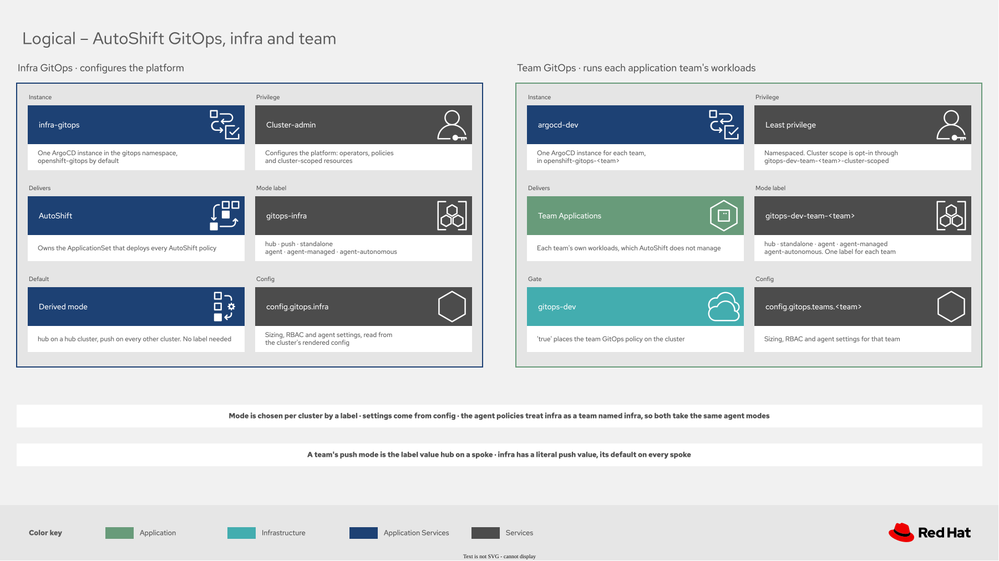
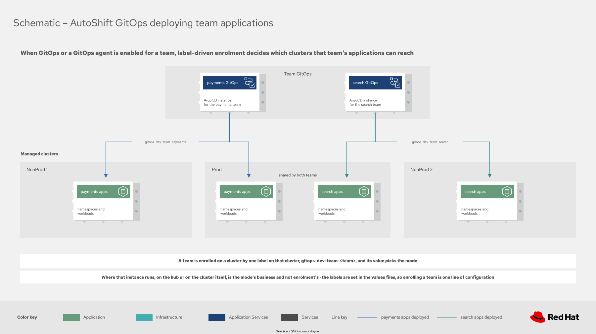
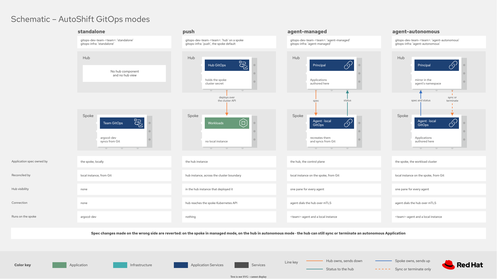

# Argo CD Agent

AutoShift runs the Argo CD Agent in two tiers. They solve different problems and a cluster can run
both at once.

| Tier | What it solves | Agents for each cluster |
|---|---|---|
| Infrastructure | The cluster's own Argo CD reports to, or is driven by, a principal on the hub | One |
| Team | Application teams share a cluster without seeing each other's namespaces | One for each enrolled team |

[](diagrams/autoshift-gitops-infra-vs-team.drawio.svg)

> [!NOTE]
> Using the Red Hat Advanced Cluster Management GitOps add-on as the infrastructure agent is in
> development and is not part of this release. Both tiers are built from AutoShift policies.

## Infrastructure agent

AutoShift creates the principal, issues every certificate with cert-manager, and enrolls each
cluster. The principal runs in `openshift-gitops-infra-agent`, and each cluster's agent is named
`<cluster>-infra`.

### Enable

The hub needs cert-manager, because every certificate on this path is issued from `autoshift-ca` or
the issuer named in `config.gitops.infra.agent.caIssuer`. On the hub clusterset:

```yaml
labels:
  cert-manager: 'true'
  gitops-agent: 'true'      # run the infrastructure principal on this hub
```

Then enroll each cluster with the mode label, which also selects the shape of the instance:

```yaml
labels:
  gitops-infra: 'agent-autonomous'   # a local instance, reporting to the hub principal
```

### Public key infrastructure

Everything derives from one secret in the principal namespace, `gitops-agent-ca`: the principal
serving certificate, the resource proxy certificate, the trust bundle each spoke receives, and every
agent client certificate. Every name is set on the `ArgoCD` CR, so AutoShift chooses them.

The principal policy issues that secret with cert-manager whenever the hub carries `gitops-agent`,
as an intermediate under `config.gitops.infra.agent.caIssuer`, which defaults to `autoshift-ca`.
Team principals each get an intermediate of their own under the issuer set by
`config.gitops.teams.<team>.agent.caIssuer`.

## Team agents

Application teams share clusters. Each team gets its own principal, its own signing certificate
authority, and a scoped `AppProject`, so one team cannot see or deploy into another team's
namespaces. A cluster runs the infrastructure agent alongside one agent for each enrolled team.

### Enable

Where a team's control plane runs and where it deploys are chosen separately, the same way they
are for infra. On the hub that hosts the team's principal:

```yaml
config:
  gitops:
    teams:
      test:
        agent:
          enabled: true
          caIssuer: 'autoshift-ca'
labels:
  gitops-agent-teams: 'true'     # run a principal here for each team with agent.enabled
```

That alone gives the team a control plane on the hub and nothing that deploys there, which suits an
application team that only deploys on spokes. To have the team deploy on the hub as well, add its
label there too: `gitops-dev-team-test: 'hub'` for the team's own Argo CD instance, or an agent mode
for an agent reporting to the principal on the same hub.

A principal serves the clusters its hub manages, because each spoke finds its principal through the
hub that manages it. A team can have a principal on more than one hub, each its own control plane
with its own certificate authority.

Each cluster that joins a team's agent needs two labels:

```yaml
labels:
  gitops-agent-enrolled: 'true'        # this cluster runs at least one team agent
  gitops-dev-team-test: 'agent'        # which team, and in which mode
```

> [!IMPORTANT]
> Those two labels must move together. A placement selector cannot match a label prefix, so
> `gitops-agent-enrolled` is what places the spoke policy, while the per-team labels only decide
> which teams. Set one without the other and the hub still builds the namespace, the client
> certificate, the mapping secret, and the source namespace entry, no agent is ever deployed, and
> every policy reports `Compliant`.

Enrollment decides reach, and nothing else: a team's applications land only on the clusters whose
labels name that team. Two teams share a cluster by both being enrolled on it, and each keeps its
own instance, project and namespaces.

[](diagrams/autoshift-gitops-team-clusters.drawio.svg)

### Projects

Each team gets a `default` project derived from its agent settings: `destinationNamespaces`
(default `<team>-*`), `sourceRepos` (default any) and `clusterResources` (default none). Add more
under `projects`, keyed by name, each entry being the `AppProject` spec as written. An entry named
`default` replaces the derived one.

```yaml
config:
  gitops:
    teams:
      test:
        projects:
          frontend:
            sourceRepos:
              - 'https://git.example.com/acme/frontend.git'
            destinations:
              - namespace: 'test-frontend'
                server: '*'
```

AutoShift creates the projects where the team's Argo CD reads them, and enforces each one exactly,
so a repository or destination removed from configuration is removed from the project:

| Team mode on a cluster | Where the projects are created |
|---|---|
| `hub` or `standalone` | The team's own instance on that cluster. Its built-in `default` is left alone unless configuration defines one |
| `agent-autonomous` | The team's agent instance on that cluster, which owns its Applications |
| `agent-managed` | The team principal on the hub, which delivers them to the agent. AutoShift fills `sourceNamespaces` with the agent namespaces unless an entry sets it |

### Where to see everything

Each principal has its own Argo CD UI on the hub, with OpenShift login and a link in the console's
application menu:

| UI | Shows | Who gets in |
|---|---|---|
| The hub's own infra instance | The hub's own AutoShift Applications | `config.gitops.infra.rbac_policies` |
| `Infra fleet Argo CD` | Every enrolled cluster's infra Applications | `config.gitops.infra.rbac_policies` |
| `<team> fleet Argo CD` | The team's Applications on every enrolled cluster | The team's `gitops_rbac_policies` and project roles |

In autonomous mode the UI mirrors each cluster's Applications, with live status, resource tree and
logs fetched from the cluster, and you can sync them or stop a running sync from it. In managed mode
it is where the Applications are authored. Project roles take effect here, and nothing grants access
by default.
Set `agent.ui: false` to run a principal without a route or login.

A team agent's instance on a spoke has no UI of its own, so a team in an agent mode uses its fleet UI.

### Namespaces a team deploys into

A team's Argo CD instance is scoped to namespaces, so it can deploy only into a namespace labeled
as managed by it. `CreateNamespace=true` cannot create one. Create each destination namespace
first, with the label:

```yaml
apiVersion: v1
kind: Namespace
metadata:
  name: test-frontend
  labels:
    argocd.argoproj.io/managed-by: openshift-gitops-test
```

The label value is the team's Argo CD namespace, `openshift-gitops-<team>` by default. Without it,
the Application reports that the namespace is not managed.

## Modes

Mode is a per-agent setting, so one team can run some clusters managed and others autonomous at the
same time.

| Label value | Mode | Who owns the `Application` resources |
|---|---|---|
| `agent` | Whatever `config.gitops.teams.<team>.agent.mode` says, default autonomous | Follows the team default |
| `agent-autonomous` | Autonomous | The spoke. The agent mirrors each one up to the hub |
| `agent-managed` | Managed | The hub. The agent pulls them down |

The same label also carries the two values that are not agent modes, `standalone` and `push`, so all
four sit on one scale: where the instance runs, and which side owns the `Application`.

[](diagrams/autoshift-gitops-modes.drawio.svg)

Neither mode conflicts with AutoShift. AutoShift builds the instance, its RBAC and its
`AppProject`, and never creates an `Application`, so the applications themselves belong to whoever
the mode says. Pick on where the team wants to work: autonomous keeps authoring on the cluster and
gives the hub a live view of what is already running there, while managed makes the hub the place
applications are declared and pushes them down.

One place the two would otherwise contend is handled for you. `policy-managed-autoshift` writes
the AutoShift `Application` into a managed hub's own Argo CD, and in `agent-managed` mode the hub
above owns that same object through the principal. Its placement excludes `agent-managed`, so the
principal is the only writer. `policy-managed-autoshift-agent` then writes that `Application` on
the hub above, in the managed hub's `<cluster>-infra` namespace, from the same
`config.managedAutoshift` entries, and the agent syncs it on the managed hub. See
[managed-autoshift](../policies/stable/managed-autoshift/README.md).

`destinationBasedMapping` decides how the principal maps an `Application` to an agent. It defaults
to `false` on both paths, which means mapping by namespace, and it is worth leaving alone. The
setting is not symmetric, and the asymmetry shows only in managed mode. For the detail, see
[Status never returns to the hub](#status-never-returns-to-the-hub).

Autonomous mode is unaffected by it, because the agent mirrors into the hub namespace that already
matches its own agent name, so nothing needs rewriting on the way back.

## Privilege

Team GitOps is meant for application teams and is least privileged. The team instance gets no
cluster-scoped access unless `gitops-dev-team-<team>-cluster-scoped` asks for it, and the agent
receives a narrow `ClusterRole` that grants `get`, `list`, and `watch` on namespaces rather than
membership of `ARGOCD_CLUSTER_CONFIG_NAMESPACES`.

The team principal is the exception, and it is forced rather than chosen. Red Hat OpenShift GitOps
reconciles `sourceNamespaces` only for a cluster-scoped instance, so AutoShift adds
`openshift-gitops-<team>-agent` to `ARGOCD_CLUSTER_CONFIG_NAMESPACES` whenever a team enables an
agent. That instance runs with the application controller disabled and reconciles nothing. It is a
separate instance from the team's own Argo CD, whose scope is unaffected.

## Verify

Each path ships an inform policy that asserts the result rather than the intent:

| Policy | What it asserts |
|---|---|
| `policy-gitops-agent-hub-ready` | For each team: namespace, signing authority, token key, principal, and rollout. For each enrolled cluster: agent namespace, client certificate, mapping secret, and the `AppProject` permit list |
| `policy-gitops-agent-spoke-ready` | For each team on this cluster: namespace, client certificate, instance, and that the agent rollout completed |

A useful manual check is the principal log, which names each agent as it authenticates:

```text
Mapped cluster fedtest-test to agent fedtest-test
client authentication successful  agent_version=0.9.0  authmethod=mtls  client=fedtest-test
An agent connected to the subscription stream
```

## Troubleshoot

These failures all report `Compliant`, because the policies that carry them hold nothing that can
fail. Work through them in order, because each one hides the one that follows it. Start by reading
the compliance message, which distinguishes a policy that had nothing to do from one that should
have done something.

### No agent runs on a cluster

Read the compliance message on the policy before anything else. Rendering nothing is a legitimate
result, so both agent policies state what a Compliant verdict covered:

```bash
oc get policy -n <cluster> policies-autoshift.policy-gitops-agent-spoke \
  -o jsonpath='{.status.details[0].history[0].message}'
```

`Compliant with nothing to show means no team runs an agent here yet` is the expected message on a
cluster that runs no team agent. If that is the message and you expected an agent, the cluster is
missing one of the two labels: `gitops-agent-enrolled` places the policy, and the per-team
`gitops-dev-team-<team>` label decides which teams. Both are needed.

If the per-team label does say an agent value and the message still reports nothing enrolled, the
two disagree, which is a defect rather than a configuration error. Confirm it by counting the
objects the hub distributed:

```bash
oc get policy -n <cluster> policies-autoshift.policy-gitops-agent-spoke \
  -o jsonpath='{.spec.policy-templates[0].objectDefinition.spec.object-templates-raw}' \
  | grep -c 'complianceType'
```

A count of zero against a label that asks for an agent is worth reporting. It reaches a cluster when
that cluster changes role or mode, because the condition deciding whether each object is emitted is
then evaluated against a state it was never tested against. Promoting a spoke to a managed hub is
the most likely trigger.

### One cluster silently leaves a team

The hub keeps every object it already created, because `musthave` never removes anything, so a
running agent survives long after its policy stopped rendering. Check that the cluster's label for
the team, `gitops-dev-team-<team>` or `gitops-infra` for infra, still reads an agent mode, and that
`gitops-agent-enrolled` is still set for a team. Removing a label does not tear anything down; set
it to `uninstall` instead.

### Applications flow in neither direction

A namespace carries only one `argocd.argoproj.io/managed-by-cluster-argocd` claim. Two principals
with `sourceNamespaces: ['*']` contest every namespace on the cluster, and the loser is denied
access to its own agent namespaces with nothing logged above debug level. List the claims and
confirm they are disjoint:

```bash
oc get ns -L argocd.argoproj.io/managed-by-cluster-argocd
```

### The principal skips its source namespaces

Red Hat OpenShift GitOps logs the following at information level, sets no status condition, and
continues:

```text
Skipping sourceNamespaces reconciliation for namespace openshift-gitops-test-agent
```

That namespace is missing from `ARGOCD_CLUSTER_CONFIG_NAMESPACES`.

### Status never returns to the hub

Applications reach the spoke, and the hub shows empty sync and health values forever. In managed
mode, `destinationBasedMapping` is `true`. The principal rewrites an incoming status update's
namespace to the agent name only when that setting is `false`, so with it enabled the update names
the spoke namespace and is looked up under that name on the hub, where nothing of that name exists.

This affects managed mode alone. In autonomous mode the agent mirrors into the hub namespace that
already carries its agent name, so the value makes no difference and status returns either way.

### A configuration change seems to apply and does not

Read the agent pod rather than the `Deployment`. The agent announces its mode in its authentication
token, so the principal reports whatever the running pod says. At one replica a rolling update needs
a surge of one, so on a node at its pod limit the new pod never schedules, the old pod keeps
serving, and the `Deployment` reports minimum availability. The readiness policies assert the
`Progressing` condition for this reason.

## Related pages

- [Config and labels](config-and-labels.md) for how values become labels
- [Values reference](values-reference.md) for every label
- [Policy behavior](policy-behavior.md) for the `musthave` merge and create semantics
- [Hub-of-hubs topology](hub-of-hubs.md) for where hub templates resolve
