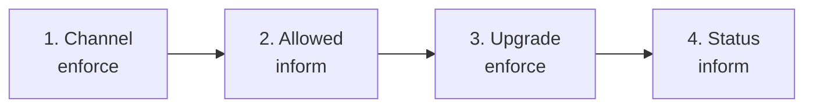
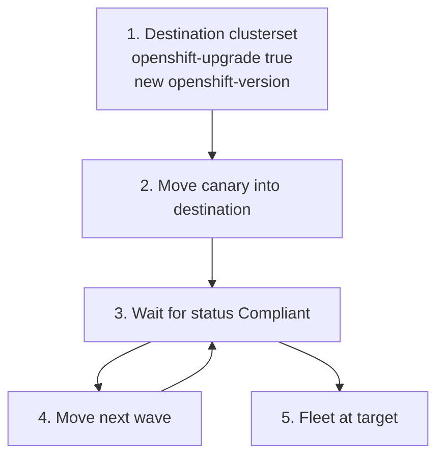

# OpenShift fleet upgrades

AutoShift upgrades OpenShift Container Platform on Day 2 the same way it configures everything else:
labels in values files, policies from GitOps, and clusterset membership as the blast-radius control.
There is no separate upgrade orchestrator. A cluster upgrades when it is opted in and its
clusterset's `openshift-version` is higher than the version the cluster is already running.

> [!NOTE]
> Topology Aware Lifecycle Manager is not used here. It needs literal upgrade coordinates in the
> root policy and cannot consume AutoShift hub-template labels. Red Hat Advanced Cluster Management
> for Kubernetes also has no progressive policy rollout hook for `Policy` objects. Membership in a
> clusterset is the staging lever that fits this model.

## What happens on one cluster

When `autoshift.io/openshift-upgrade: 'true'` is set, four policies run in order. All share one
placement. The Cluster Version Operator (CVO) still performs the upgrade; the policies only set the
channel, validate the target, write `desiredUpdate`, and report completion.



| Step | Policy | Mode | What it does |
|------|--------|------|--------------|
| 1 | `policy-openshift-upgrade-channel` | enforce | Sets `ClusterVersion.spec.channel` and `spec.upstream` (see [Disconnected clusters](#disconnected-clusters) for how the graph is chosen), so `status.availableUpdates` recomputes for the desired channel and graph. A disconnected cluster needs the upstream set here: step 2 cannot pass until the CVO reads the local graph. Without this, a y-stream target can deadlock the next check. |
| 2 | `policy-openshift-upgrade-allowed` | inform | Confirms the target is safe to apply. Compliant when the target is already running, appears in `status.availableUpdates` with a release image, or is already accepted (`status.desired.version` or a `Partial` history entry). NonCompliant on a plain miss (wrong or unpublished version). A `Recommended: False` entry under `status.conditionalUpdates` is handled by a sibling check; see [Conditional updates](#conditional-updates-recommended-false). On a disconnected cluster, a third check fails when the target release has no signature; see [Disconnected clusters](#disconnected-clusters). **Step 3 depends on this policy.** |
| 3 | `policy-openshift-upgrade` | enforce | Writes `spec.upstream` again and, when not already `Progressing`, `spec.desiredUpdate.version` plus `spec.desiredUpdate.image`. The image is copied from `status.availableUpdates` (or from `status.conditionalUpdates` when conditional upgrades are allowed). The CVO then upgrades the cluster. |
| 4 | `policy-openshift-upgrade-status` | inform | Compliant only after the latest `Completed` history entry is at or above the target. **This is the wave-done gate.** Do not use step 3 for that: it goes Compliant as soon as `desiredUpdate` is written, long before the CVO finishes. |

Guards built into the enforce policy:

- **Semver.** `desiredUpdate` is written only when `target > current`. Clusters already at or above the
  target are a Compliant no-op. Downgrades are never attempted.
- **In flight.** While `Progressing` is `True`, the policy does not rewrite `desiredUpdate`, so it
  does not fight an upgrade that has already started.
- **Dependencies.** Step 3 stays Pending until steps 1 and 2 are Compliant.

> [!NOTE]
> Completion is decided in template logic, not by matching `status.history` as a list field. Red Hat
> Advanced Cluster Management does not reliably match status lists, so the status policy forces
> NonCompliant with a `mustnothave` on the `ClusterVersion` until the target is reached. Upgrade
> failure visibility still comes from OpenShift upgrade alerts, not from these policies.

## Labels

Set these on the **target clusterset** (or override one cluster). Prefix in values files is bare;
the `cluster-labels` policy stamps `autoshift.io/` at runtime.

| Label | Purpose | Example |
|-------|---------|---------|
| `openshift-upgrade` | Opt the cluster in to Day 2 upgrades | `'true'` |
| `openshift-version` | Target OpenShift version. Shared with operator-catalog tooling. Upgrade runs only when this is greater than the running version. | `'4.22.18'` |
| `openshift-upgrade-channel` | `ClusterVersion` channel | `'stable-4.22'` |
| `openshift-upgrade-allow-conditional` | Allow a `Recommended: False` target from `status.conditionalUpdates` | `'false'` |

Example clusterset fragment:

```yaml
hubClusterSets:
  managed-upgrade:
    labels:
      openshift-upgrade: 'true'
      openshift-version: '4.22.18'
      openshift-upgrade-channel: 'stable-4.22'
      openshift-upgrade-allow-conditional: 'false'
```

## Config

The OpenShift Update Service graph URL is config, not a label. The channel policy reads
`config.openshift-upgrade.upgradeGraphUrl` from the cluster's rendered-config ConfigMap and writes it
to `ClusterVersion.spec.upstream`. See [config-and-labels.md](config-and-labels.md). You do not need
to set this key if the cluster can reach the public graph, or is disconnected and has an OpenShift
Update Service on itself or its hub.

| Key | Purpose | Default |
|-----|---------|---------|
| `config.openshift-upgrade.upgradeGraphUrl` | OpenShift Update Service graph. Overrides the default. | A disconnected cluster uses the OpenShift Update Service on itself or on its hub; any other cluster uses `https://api.openshift.com/api/upgrades_info/v1/graph` |

```yaml
hubClusterSets:
  managed-upgrade:
    config:
      openshift-upgrade:
        upgradeGraphUrl: 'https://api.openshift.com/api/upgrades_info/v1/graph'
```

## Disconnected clusters

A cluster that cannot reach Red Hat needs two things that a connected cluster gets from the
internet: an update graph, and the signatures that let the CVO verify a release. oc-mirror v2
produces both, and AutoShift applies both from values.

| Need | oc-mirror output in `working-dir/cluster-resources/` | Values key | Applied by |
|------|------|------|------|
| Update graph | `updateService.yaml`, written when the `ImageSetConfiguration` sets `graph: true` | `config.update-service` | `policies/stable/update-service` |
| Release signatures | `signature-configmap.json` | `config.disconnected.releaseSignatures` | `policies/stable/disconnected-mirror` |

The generated `ImageSetConfiguration` sets `graph: true`. It mirrors the OpenShift Update Service
Operator from `make generate-imageset`, which includes every declared operator, and from
`scripts/generate-imageset-config.sh` run against your own values when `update-service` is `'true'`.

1. Mirror with the generated `ImageSetConfiguration`.
2. Print the values from the oc-mirror output:

   ```bash
   ./scripts/oc-mirror-to-values.sh mirror/working-dir/cluster-resources
   ```

   The script prints `config.update-service` and one `releaseSignatures` entry per release digest.
   Paste the `releaseSignatures` entries into the values file that holds `config.disconnected`.
   `config.update-service` is only needed when the mirror does not use oc-mirror's default paths.
3. Enable the OpenShift Update Service with `update-service: 'true'` on the hub, or on whichever
   clusters should serve the graph. It reads the mirror registry CA from the same
   `config.disconnected.mirrorRegistry` the cluster uses to pull, and finds the mirrored releases
   and graph image at `<host>[/<path>]/openshift/release-images` and
   `<host>[/<path>]/openshift/graph-image:latest`.

Every `disconnected-mirror` cluster then finds its update graph without further configuration. The
channel policy writes `ClusterVersion.spec.upstream` from the first of these that exists:

1. `config.openshift-upgrade.upgradeGraphUrl`, when set.
2. An OpenShift Update Service on the cluster itself.
3. The OpenShift Update Service on the hub that manages the cluster.

A disconnected cluster with none of these fails the channel policy with a message naming the fix,
rather than pointing at a public graph it cannot reach. A connected cluster without an explicit URL
uses the public graph. The service is found by its Route, `<name>-route` in
`openshift-update-service`, where `name` is `config.update-service.name` (default `autoshift`).
Set `name` where every cluster sees it if you change it.

A cluster that does not trust the Route certificate cannot read the graph. Add the serving cluster's
ingress CA to the reading cluster's `proxy/cluster` `trustedCA` if that cluster uses a private
certificate.

```yaml
config:
  disconnected:
    releaseSignatures:
      - version: '4.22.18'
        digest: 'sha256:<64 hex characters>'
        signatures:
          - '<base64 signature>'
```

### Where the update service runs in a hub of hubs

Each layer's Red Hat Advanced Cluster Management places policies on its own clusters, and "the hub
that manages the cluster" means that placing hub. Choose where the service runs with the
`update-service` label:

| Layout | Labels | Result |
|---|---|---|
| One service per managed hub | `update-service: 'true'` on the managed hubs' clusterset in the hub of hubs' values | Each managed hub serves its own spokes, and uses its own service for its own upgrades |
| One central service on the hub of hubs | `update-service: 'true'` on the hub of hubs only | Managed hubs find it on their own. Their spokes look on their managed hub, so set `config.openshift-upgrade.upgradeGraphUrl` once in each managed hub's values |
| Both | Both labels | Every cluster uses the nearest service: its own, then its hub's |

Every serving cluster needs the release images and graph image in a mirror it can reach, and the
`releaseSignatures` list of the clusters it serves.

`releaseSignatures` is required on every cluster with `disconnected-mirror: 'true'`. AutoShift owns
the `openshift-config-managed/mirrored-release-signatures` ConfigMap it writes, so the list in values
is the whole set:

- Add an entry for each release a cluster might move to. A release can carry more than one
  signature.
- Remove an entry to prune its signatures from every cluster. Keep the entry for any release a
  cluster still targets.
- Set `releaseSignatures: []` to delete the ConfigMap.
- Signatures applied by hand from oc-mirror's file are removed. Put them in values instead.

Before the upgrade starts, `openshift-upgrade-signature` checks that the target release digest has a
signature on the cluster. When it does not, Governance names the digest and the upgrade stays
blocked, rather than the CVO rejecting the release after `desiredUpdate` is written.

## Roll out a new version to a cluster

There are two supported patterns. Use the simple path when one clusterset already owns the cluster
and you only need to bump OpenShift. Use waves when you must stage a fleet (or a new AutoShift
release together with a new OpenShift version).

### Simple path: bump the target on the owning clusterset

1. Confirm the cluster is healthy and that the target appears (or will appear after the channel
   change) in the update graph for that channel.
2. In the clusterset values file that already owns the cluster, set:

   ```yaml
   labels:
     openshift-upgrade: 'true'
     openshift-version: '4.22.20'         # new target, must be > current
     openshift-upgrade-channel: 'stable-4.22'
   ```

3. Commit and push. OpenShift GitOps syncs; Red Hat Advanced Cluster Management places the policies.
4. Watch the sequence on that cluster (see [Watch progress](#watch-progress)):
   - channel Compliant
   - allowed Compliant (or conditional NonCompliant: read the risk before overriding)
   - upgrade Compliant (`desiredUpdate` written)
   - status Compliant (cluster actually at target)
5. Leave `openshift-upgrade: 'true'` if future bumps on the same clusterset should auto-apply, or set
   it back to `'false'` if upgrades should be opt-in per bump.

> [!IMPORTANT]
> Never flip `openshift-upgrade: 'true'` on a clusterset that already holds many clusters at an older
> version unless you intend every member to upgrade together. Red Hat Advanced Cluster Management fans the
> policy out with no per-cluster staging inside one placement.

### Fleet path: empty upgrade clusterset and move clusters in waves

Blast radius is membership. Create (or reuse) a clusterset whose labels already describe the new
OpenShift target, keep it empty or canary-only, then move clusters into it one wave at a time.

1. **Prepare the destination clusterset** with the new OpenShift labels (`openshift-upgrade: 'true'`,
   new `openshift-version`, matching channel). Prefer a versioned AutoShift release so the destination
   is empty until you move members. See [gradual-rollout.md](gradual-rollout.md).
2. **Move a canary** into that clusterset. Prefer a git change to
   `config.clusterSet` / `config.versionTag` in `autoshift/values/clusters/<name>.yaml` so
   [cluster-set-assignment](cluster-set-assignment.md) stamps membership. Do not rely on a durable
   `oc label` override if assignment owns the cluster.
3. **Wait for the canary** until `policy-openshift-upgrade-status` is Compliant (and the GitOps
   Application for the upgrade policies is Healthy).
4. **Move the next wave**, verify, repeat until the fleet is on the new version.
5. **Rollback** a membership move with `git revert` of the assignment commit. That returns the
   cluster to the previous clusterset; it does not roll OpenShift backward.



A wave is a commit that changes membership for N clusters. OpenShift GitOps reconciles it. The
completion gate tells you when the next commit is safe. Nothing auto-proceeds to the next wave;
that gate is your commit cadence or a thin script that reads compliance.

## Conditional updates (`Recommended: False`)

Sometimes the CVO lists the target under `status.conditionalUpdates` instead of
`status.availableUpdates`, with `Recommended: False`. That means a known risk matched this cluster.
The inform policy `openshift-upgrade-allowed-conditional` fails with the CVO reason and risk text, and
Governance shows that message. The enforce policy does not start.

To accept that risk after review and a canary:

```yaml
labels:
  openshift-upgrade-allow-conditional: 'true'
```

Effects:

- The conditional inform gate stops failing.
- The plain allowed gate treats the conditional release image as found.
- The enforce policy copies `desiredUpdate.image` from `status.conditionalUpdates`.

Leave the label at `'false'` (or unset) unless that override is intentional. Do not set `'true'` on a
populated clusterset before a canary has completed the same target.

## Watch progress

Prefer the **status** policy, not the enforce policy:

```bash
oc get policy -n policies-autoshift policy-openshift-upgrade-status \
  -o jsonpath='{range .status.status[*]}{.clustername}{"\t"}{.compliant}{"\n"}{end}'
```

See every stage for the upgrade set:

```bash
oc get policy -n policies-autoshift \
  -o custom-columns=NAME:.metadata.name,COMPLIANT:.status.compliant \
  | grep openshift-upgrade
```

OpenShift GitOps ships a health check for `Policy`. The Application that deploys these policies is
Healthy only when every policy in the set is Compliant. Because the status policy is included, that
means the upgrade finished. Expect the Application to sit Degraded for the duration of an upgrade;
that is the gate working.

## Hub-of-hubs

Each Red Hat Advanced Cluster Management layer only sees its own clusters. Roll top-down
(hub-of-hubs, then spoke hubs, then leaf spokes) so each hub runs a version that supports the clusters
it manages. Apply the upgrade labels on the right clusterset at each layer and run waves in that
order. See [hub-of-hubs.md](hub-of-hubs.md).

## See also

- [gradual-rollout.md](gradual-rollout.md): versioned clustersets for blue/green AutoShift releases
- [cluster-set-assignment.md](cluster-set-assignment.md): declarative membership moves for waves
- [hub-of-hubs.md](hub-of-hubs.md): topology and per-layer ownership
- Policy sources: `policies/stable/openshift-upgrade/`
