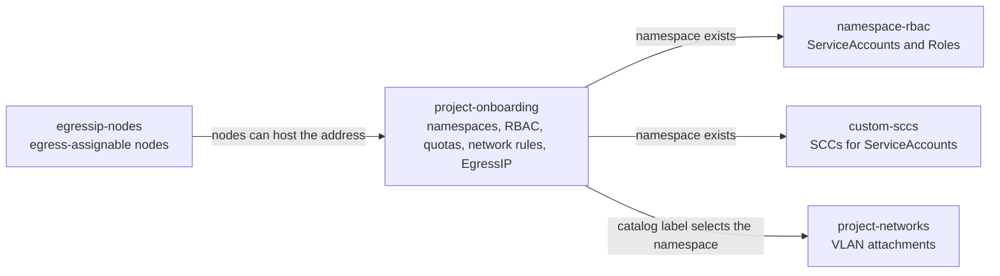

# Project onboarding and namespace management

AutoShift can manage the namespaces that application teams work in, from the same values files that
configure the rest of a cluster. Five policies cover it. Each one is enabled by its own label and
reads its own key of the `config:` block, so you can adopt them one at a time.

| Policy | Label | Config key | What it manages |
|---|---|---|---|
| [project-onboarding](../policies/stable/project-onboarding/README.md) | `project-onboarding` | `projects`, `projectDefaults` | One namespace (an OpenShift Project) per project, with labels, annotations, group RoleBindings, a ResourceQuota and LimitRange, NetworkPolicies, an EgressFirewall, AdminNetworkPolicies, and an EgressIP. Opt-in deletion of the namespaces it created |
| [namespace-rbac](../policies/stable/namespace-rbac/README.md) | `namespace-rbac` | `namespaceRbac` | ServiceAccounts, Roles with exact rules, and RoleBindings to those Roles or to the built-in ClusterRole `edit` or `view`, in namespaces that already exist |
| [custom-sccs](../policies/stable/custom-sccs/README.md) | `custom-sccs` | `securityContextConstraints` | SecurityContextConstraints, granted to named ServiceAccounts through RBAC only |
| [project-networks](../policies/stable/project-networks/README.md) | `project-networks` | `projectNetworks` | ClusterUserDefinedNetworks that attach namespaces to a VLAN as a secondary network |
| [egressip-nodes](../policies/stable/egressip-nodes/README.md) | `egressip-nodes` | `egressIPNodes` | The `k8s.ovn.org/egress-assignable` label on the nodes that can carry EgressIP addresses |

Each policy README is the configuration guide for that policy: every key, its type and default, an
example, and what happens on invalid input. Every key is also listed in the
[values reference](values-reference.md), and `autoshift/values/clustersets/_example.yaml` holds a
complete example of each block. This page explains how the policies fit together.

## How the policies fit together



- **Groups.** project-onboarding binds group names, it does not create groups. The groups must
  exist in OpenShift, for example through LDAP group sync or the `groups` claim of an OpenID Connect
  login.
- **Namespaces.** project-onboarding is the only policy of the set that creates a namespace.
  namespace-rbac and custom-sccs act in namespaces that already exist and report a namespace that
  does not, so onboard a project first, or point them at a namespace created another way.
- **Network attachment.** project-networks selects namespaces by label. A catalog label of
  project-onboarding, such as `network.example.com/vlan-{vlan}: 'true'`, together with a project
  field `vlan: '70'`, labels the project namespace so that the network attaches it.
- **Egress addresses.** A project `egressIP` renders an EgressIP object, but OVN-Kubernetes assigns
  its address only to a node that carries `k8s.ovn.org/egress-assignable`. egressip-nodes sets that
  label on the nodes you select.

The policies are independent otherwise. None of them requires another to be enabled, and each one
reports its own errors.

### Shared behavior

The policies follow the same rules, so what you learn from one applies to the others:

- **Maps, not lists.** Every collection is a map keyed by name, because AutoShift replaces lists
  whole when it merges values files. A cluster file can therefore change or turn off one entry that
  a clusterset file declares, with `enabled: false` or `false`, without restating the others.
- **Ownership labels.** Every object a policy creates carries `autoshift.io/managed-by: <policy>`.
  An object of the same name without that label belongs to someone else: it is reported and never
  changed or taken over.
- **Exact objects.** RBAC objects, quotas, network objects, and SCCs are enforced with
  `mustonlyhave`, so a value removed from the configuration is removed from the cluster.
- **No silent deletion.** An object that is no longer declared is reported, never deleted. Only
  project-onboarding can delete: owned objects with its prune label, see [Pruning](#pruning), and
  the namespaces it created with a second label as well, see
  [Namespace deletion](#namespace-deletion).
- **Values are data.** No configuration value is evaluated as a template. A value that would break
  a template, such as `{{`, is refused or rendered literally.
- **An enforcing Policy and a -test Policy.** Each policy directory renders an enforcing Policy
  from `manifests/` and an inform-only Policy from `test/`, named with a `-test` suffix, for example
  `policy-custom-sccs` and `policy-custom-sccs-test`. The enforcing Policy applies the declared
  state. The -test Policy reports what is not applied: errors, drift of `mode: inform` projects, and
  stale objects. Neither depends on the other. A policy that needs "every entry applied" depends on
  the -test Policy.
- **Status ConfigMaps.** A policy that skips one bad entry and applies the rest writes the errors to
  a ConfigMap in `open-cluster-management-agent-addon` on the managed cluster, and its -test Policy
  stays NonCompliant while that ConfigMap exists. A policy whose configuration is all or nothing
  fails its hub template instead, and leaves the live objects as they are.

| Policy | On invalid input | Where to read the errors |
|---|---|---|
| project-onboarding | The project is skipped, the others apply | ConfigMaps `project-onboarding-status-<shard>` |
| namespace-rbac | The entry or namespace is skipped, the others apply | ConfigMap `namespace-rbac-status` |
| custom-sccs | The SCC entry is skipped, the others apply | ConfigMap `custom-sccs-status` |
| project-networks | Nothing is applied | The hub template error on the Policy |
| egressip-nodes | Nothing is applied | The hub template error on the Policy; missing or stray nodes in ConfigMap `egressip-nodes-status` |

To list every status ConfigMap of the set on a managed cluster:

```bash
oc get configmap -n open-cluster-management-agent-addon | grep -E 'project-onboarding-status|namespace-rbac-status|custom-sccs-status|egressip-nodes-status'
```

## Onboard a team's project, end to end

This example onboards the project `payments-api` for the team `payments`. The team gets a namespace
with admin, edit, and view access for its groups, a quota, a default-deny network profile with two
allow rules, a fixed egress address for its database firewall, a VLAN attachment, a CI
ServiceAccount that can start builds, and an SCC that lets its builder run with a fixed UID range.

Put shared conventions in a clusterset file, and the team's own entries in the same file or a
cluster file. The precedence is the usual one: cluster over clusterset over global, as a deep merge.

### Step 1: enable the policies

In the clusterset values file, for example `autoshift/values/clustersets/hub.yaml`:

```yaml
hubClusterSets:
  hub:
    labels:
      project-onboarding: 'true'
      project-onboarding-prune: 'false'   # report stale objects, delete nothing
      namespace-rbac: 'true'
      custom-sccs: 'true'
      project-networks: 'true'
      egressip-nodes: 'true'
```

Never put these labels on a ManagedCluster by hand. The `cluster-labels` policy stamps them from the
values files.

### Step 2: define the shared conventions

`projectDefaults` holds what every project shares: group-name patterns, the label catalog, quota
sizes, and network profiles. A project supplies only the fields those templates need.

```yaml
    config:
      projectDefaults:
        groups:
          admin: '{team}-admins'
          write: '{team}-developers'
          read: '{team}-viewers'
        labels:
          team:
            key: example.com/team
            value: '{team}'
          vlan:
            key: 'network.example.com/vlan-{vlan}'
            value: 'true'
        sizes:
          small:
            quota:
              requests.cpu: '4'
              requests.memory: 8Gi
              limits.memory: 16Gi
              pods: '50'
            limitRange:
              default: {cpu: 500m, memory: 512Mi}
              defaultRequest: {cpu: 100m, memory: 128Mi}
        networkProfiles:
          strict:
            defaultDeny: {ingress: true, egress: true}
            rules:
              dns: {direction: egress, action: allow, to: {dns: true}}
              router: {direction: ingress, action: allow, from: {router: true}}
```

### Step 3: declare the project

```yaml
      projects:
        payments-api:
          displayName: Payments API
          team: payments
          vlan: '70'
          size: small
          networkProfile: strict
          network:
            rules:
              to-database:
                direction: egress
                action: allow
                to: {cidrs: ['203.0.113.0/24']}
                ports: [5432]
          egressIP: ['198.51.100.50']
```

project-onboarding renders, in the namespace `payments-api`:

- the Namespace, labeled `example.com/team: payments` and `network.example.com/vlan-70: 'true'`,
  plus the ownership labels `autoshift.io/project: payments-api` and
  `autoshift.io/managed-by: project-onboarding`;
- the RoleBindings `autoshift-admin`, `autoshift-write`, and `autoshift-read`, for the groups
  `payments-admins`, `payments-developers`, and `payments-viewers`;
- the ResourceQuota `autoshift-quota` and the LimitRange `autoshift-limits` from the size `small`;
- the default-deny NetworkPolicies, a NetworkPolicy for each in-cluster allow rule, and the
  EgressFirewall `default` that allows `203.0.113.0/24` on port 5432 and denies other external
  egress;
- the cluster-scoped EgressIP `autoshift-payments-api` with the address `198.51.100.50`.

### Step 4: make nodes assignable for the egress address

The address must lie in the node subnet of an assignable node. Select the nodes on that network:

```yaml
      egressIPNodes:
        worker-0.example.com: true
        worker-1.example.com: true
```

### Step 5: attach the VLAN

The network selects the namespace by the catalog label from step 2. `physicalNetworkName` must name
a localnet of the `nmstate` OVN bridge mappings.

```yaml
      projectNetworks:
        vlan-70:
          vlan: 70
          physicalNetworkName: physnet-vlan70
          subnets: ['10.70.0.0/24']
          namespaceSelector:
            matchLabels:
              network.example.com/vlan-70: 'true'
```

### Step 6: give the CI ServiceAccount exact rights

```yaml
      namespaceRbac:
        payments-api:
          serviceAccounts:
            payments-ci: true
          roles:
            start-builds:
              rules:
                - apiGroups: [build.openshift.io]
                  resources: [buildconfigs/instantiate]
                  verbs: [create]
          roleBindings:
            start-builds:
              role: start-builds
              serviceAccounts:
                payments-api/payments-ci: true
```

Every rule passes a safety gate. Wildcards, the `escalate`, `bind`, and `impersonate` verbs, RBAC
and SCC resources, and `secrets` without `resourceNames` are refused, see the
[namespace-rbac README](../policies/stable/namespace-rbac/README.md#safety-gate). Starting a build
runs it with the secrets of its BuildConfig, so grant it only to a ServiceAccount you would trust
with them.

An identity that manages ordinary workloads in the namespace can be bound to the built-in
ClusterRole `edit` or `view` instead of a long list of rules, with `clusterRole` in place of `role`:

```yaml
          roleBindings:
            deployer:
              clusterRole: edit             # edit or view only
              serviceAccounts:
                payments-api/payments-ci: true
```

The binding is a RoleBinding, so the grant stops at the namespace. Every other ClusterRole,
`admin` and `cluster-admin` included, is refused. The safety gate does not check the rules of
`edit` and `view`, because the cluster defines them. `edit` reads every Secret and can act as every
ServiceAccount of its namespace, so grant it only where those ServiceAccounts hold no wider rights.
A ServiceAccount that a long-lived token Secret can act as, directly or through other bindings, is
never bound to `edit` or `view`, see
[ClusterRole bindings](../policies/stable/namespace-rbac/README.md#clusterrole-bindings).

### Step 7: grant an SCC to the builder

```yaml
      securityContextConstraints:
        payments-builder:
          spec:
            runAsUser:
              type: MustRunAsRange
              uidRangeMin: 1000
              uidRangeMax: 1999
          serviceAccounts:
            payments-api/builder: true
```

Fields that `spec` does not set keep the built-in `nonroot-v2` posture. A privileged setting is
refused unless the entry sets `allowPrivileged: true`, see the
[custom-sccs README](../policies/stable/custom-sccs/README.md#safety-gate).

### Step 8: verify

After OpenShift GitOps syncs the change and the policies evaluate:

```bash
oc get policy -A | grep -E 'project-onboarding|namespace-rbac|custom-sccs|project-networks|egressip-nodes'
oc get namespace payments-api --show-labels
oc get rolebinding,resourcequota,limitrange,networkpolicy,egressfirewall -n payments-api
oc get egressip autoshift-payments-api -o yaml      # status.items names the assigned node
oc get clusteruserdefinednetwork vlan-70
oc get scc payments-builder
```

A -test Policy that stays NonCompliant names its status ConfigMap. Read it for the exact error, see
[Shared behavior](#shared-behavior).

## Adopt existing namespaces

A namespace that already exists and was not created by project onboarding is never taken over by
accident. To bring one under management:

1. Declare it with `adopt: true` and no `mode`. The project starts as `inform`: the policy reports
   what it would change, and changes nothing.

   ```yaml
   projects:
     legacy-app:
       team: legacy
       adopt: true
   ```

2. Review the drift. The -test Policy of the project's shard is NonCompliant for each object that
   differs from the declared state, and each status ConfigMap lists the configuration errors.
3. Set `mode: enforce` to complete the adoption. The namespace gets its ownership labels, and the
   declared objects are written. Labels and annotations that other tools set on the namespace are
   kept.

A namespace that carries `autoshift.io/project` for another project is never taken over, even with
`adopt: true`. To move a namespace between projects, remove the old project's ownership label first.
Platform namespaces such as `openshift-*`, `kube-*`, and `default` are refused with no override.

The same applies to RoleBindings and other objects of a generated name: an object of that name
without the ownership label is reported and never changed. Rename the entry, or delete the foreign
object by hand once you have confirmed it can go.

### Migrate from hand-managed namespaces

To move a set of namespaces that were managed by hand or by another tool:

1. Write a project entry for each namespace, with `adopt: true` and the groups it already binds.
   With `adopt: true` and no `mode`, each starts as `inform`.
2. Keep `project-onboarding-prune` and `project-onboarding-delete-namespaces` at `'false'`.
   Objects that the old tools created are not owned by project onboarding, so they are never
   pruned, and an adopted namespace is never deleted, but leaving both off also means a mistake in
   the new entries is reported rather than acted on.
3. Compare the reported drift with what you expect, then set `mode: enforce` project by project.
4. Remove the old RoleBindings, quotas, and NetworkPolicies by hand once the managed ones are in
   place. project-onboarding names its objects `autoshift-*`, so they sit next to the old ones
   until you remove them.

For a dry run of everything at once, set the deployment `REMEDIATION` to `inform`, which
`autoshift.dryRun` does: every enforce ConfigurationPolicy follows it.

## Pruning

Deletion is opt-in and limited to project onboarding. With `project-onboarding-prune: 'true'`,
objects that project onboarding owns but no longer declares are deleted, and catalog labels that are
no longer applied are removed from the namespace. Examples are the RoleBinding of a group that was
removed, the quota of a project that no longer sets `size`, the NetworkPolicy of a removed rule,
and every owned object of a project removed from `config.projects`. With any other value, the
default, they are reported by the -test Policies and left in place.

Pruning never deletes a namespace. Removing a project leaves its namespace and its workloads in
place, unless [namespace deletion](#namespace-deletion) is on as well.

Pruning holds back while the configuration is in doubt. Nothing of a project that has errors is
deleted while the error stands, and no sweep runs when the rendered configuration cannot be read or
has no `projects` key. An explicit `projects: {}` is a deliberate removal and sweeps every owned
object. The full rules are in the
[project-onboarding README](../policies/stable/project-onboarding/README.md#pruning).

The other policies of the set never delete. namespace-rbac, custom-sccs, project-networks, and
egressip-nodes report an object that is no longer declared, and you delete it by hand. Each README has the commands.

## Namespace deletion

> [!WARNING]
> Deleting a namespace is irreversible. Every workload, Secret, and other object in it goes with
> it, including objects that project onboarding never managed. Leave this off unless you need it.

Project onboarding can delete the namespace of a removed project, but only one that it created
itself. A namespace that already existed, or that a project adopted with `adopt: true`, is never
deleted. Three settings must all allow it: both cluster labels, and `deleteOnRemoval: true` on the
project while it is still declared.

In a clusterset values file, for example `autoshift/values/clustersets/managed.yaml`:

```yaml
managedClusterSets:
  managed:
    labels:
      project-onboarding: 'true'
      project-onboarding-prune: 'true'
      project-onboarding-delete-namespaces: 'true'
    config:
      projectDefaults:
        maxNamespaceDeletes: 2            # circuit breaker, recommended
        namespaceDeleteGracePeriod: 24h   # the default, at least 1h
      projects:
        payments-sandbox:
          team: payments
          environment: DEV
          deleteOnRemoval: true
```

When onboarding creates a namespace, it writes a creation record on it: the label
`autoshift.io/onboarding-created`, the project name, the project's `deleteOnRemoval` and mode, and
the creation time. On a later evaluation it stamps the namespace's `metadata.uid` into the record.
A namespace restored from a backup, or applied again from a saved copy, gets a new uid, so its
record no longer matches and it is never deleted.

Deletion is two-phase. The first evaluation that finds the project gone only marks the namespace
with `autoshift.io/onboarding-pending-deletion-since`. A later evaluation deletes it once the
project has stayed undeclared for the whole `namespaceDeleteGracePeriod`. Declaring the project
again within that time removes the mark and cancels the deletion.

Before it deletes, onboarding checks every guard again:

- the namespace holds no storage: no PersistentVolumeClaims, VolumeSnapshots, ObjectBucketClaims,
  DataVolumes, or VirtualMachines;
- no current project, in any shard, declares the namespace, so renaming a project that keeps its
  namespace deletes nothing;
- `config.projects` has at least one project, because an empty or missing map is read as a broken
  configuration, not as a removal;
- the namespace is not a platform namespace, the namespace of the onboarding Policies, or one named
  after a ManagedCluster;
- the project's last recorded mode is `enforce`, and the deployment is not a dry run. The -test
  Policies never carry a deletion.

`maxNamespaceDeletes` caps how many namespaces one evaluation may delete, counted across all eight
shards. When more would go, none is deleted and each is reported, so a values change that drops
many projects by mistake is reported rather than acted on. Setting
`project-onboarding-delete-namespaces` back to `'false'` stops every deletion and removes every
mark. Each namespace that is marked, kept, or blocked is listed in the status ConfigMap of its
shard with the reason.

The full rules, including who can forge a record and how to end a dry run safely, are in the
[project-onboarding README](../policies/stable/project-onboarding/README.md#namespace-deletion).

## Sharding and size limits

The hub resolves each Policy into one object per managed cluster, and etcd rejects an object over
1.5 MiB. To keep many projects within that limit, project onboarding is split into eight Policies,
`policy-project-onboarding-0` to `policy-project-onboarding-7`, each with its -test Policy,
`policy-project-onboarding-<shard>-test`. A project belongs to shard
`adler32(name) mod 8`, which never changes while its name does not. To find the shard of a project:

```bash
python3 -c 'import sys, zlib; print(zlib.adler32(sys.argv[1].encode()) % 8)' payments-api
```

Each shard renders, reports, and prunes only its own projects, and writes its own status ConfigMap,
`project-onboarding-status-<shard>`. Checks across projects, such as two projects that declare the
same namespace or egress address, still see every project.

The hub estimates the size of each shard Policy and keeps it below 1 MiB. When the next project of a
shard would pass that, it and the later projects of that shard in name order are not rendered, and
the status key `project-onboarding.size` names them. Their live objects stay as they are. As a guide,
a cluster holds several hundred projects that bind groups only, and a few hundred that use every
feature, depending on how the names spread over the shards. More than 3,200 declared projects fail
the hub template of every shard. The measured figures are in the
[project-onboarding README](../policies/stable/project-onboarding/README.md#size-limit).

To hold more, split the projects across clusters, or keep projects small.

## Prerequisites

- Red Hat Advanced Cluster Management for Kubernetes 2.16 or later, for the template functions the
  hub templates use. Version 2.17 is tested.
- OVN-Kubernetes, for EgressFirewall, EgressIP, AdminNetworkPolicy, and ClusterUserDefinedNetwork.
  project-onboarding reports a missing EgressFirewall, EgressIP, or AdminNetworkPolicy CRD in its
  status rather than rendering a partial project.
- For project-networks, the `nmstate` policy with an OVN bridge mapping for each
  `physicalNetworkName`.
