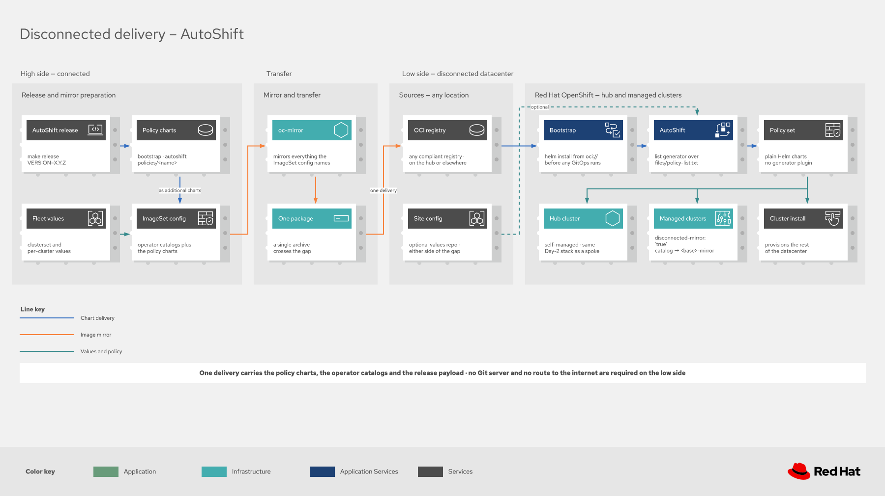

# AutoShift release and OCI guide

This guide covers how AutoShift releases are created, how OCI mode works, and how to manage OCI-based deployments. For step-by-step installation, see the [Quick Start Guide](quickstart.md).

## How OCI mode works

AutoShift has two deployment modes. Setting `autoshiftOciRepo` selects OCI; without it, policies come from git.

### Git mode (default)
```
AutoShift Chart (from Git)
    |
ApplicationSet with Git Generator
    |
Auto-discovers policies/ directories in Git
    |
Deploys each policy as an ArgoCD Application
```

### OCI mode (`autoshiftOciRepo` set)
```
AutoShift Chart (from OCI)
    |
ApplicationSet with List Generator
    |
Reads policy-list.txt (generated at release time; every policy is a Helm chart)
    |
Deploys each policy from the OCI registry (every policy is a Helm chart)
```

The OCI chart includes a `files/policy-list.txt` that is **automatically generated during the release process** by discovering all policies in the `policies/` directory. No manual maintenance is required.

### Key differences

| Aspect | Git Mode | OCI Mode |
|--------|----------|----------|
| **Generator** | `git:` - auto-discovers `policies/{stable,certified,community}/*` | `list:` - reads `policy-list.txt` |
| **Source** | Git repository path | OCI chart reference |
| **Version** | Git branch/tag | Chart version (pinned) |
| **Dynamic** | Auto-discovers new policies | Fixed to released policies |
| **Use Case** | Development, customization | Production, version-pinned |

## OCI registry structure

When a release is created with `make release`, charts are published to the registry in this structure:

```
quay.io/autoshift/
├── bootstrap/
│   ├── openshift-gitops          # Bootstrap chart for GitOps operator
│   └── advanced-cluster-management  # Bootstrap chart for ACM operator
├── autoshift                      # Main chart (ApplicationSet)
└── policies/
    ├── openshift-gitops           # Policy: Helm chart (takes over GitOps)
    ├── advanced-cluster-management # Policy: PolicyGenerator (takes over ACM)
    ├── advanced-cluster-security  # Policy: PolicyGenerator
    └── ... (additional policies: mostly PolicyGenerator dirs, a few Helm charts)
```

All charts share the same version number, set during the release process.

## OCI configuration values

When deploying from OCI, two values control the behavior. These are set automatically by the `install-autoshift.sh` script generated during the release:

```yaml
# Where the policy charts are published, and the value that selects OCI mode.
# Change this if you release your own charts.
autoshiftOciRepo: oci://quay.io/autoshift/policies

# The release to deploy. Argo CD does not reliably track a mutable tag, so pin it.
# In an ArgoCD Application, inject it from the Application's own targetRevision:
#   parameters:
#     - name: autoshiftOciVersion
#       value: $ARGOCD_APP_SOURCE_TARGET_REVISION
autoshiftOciVersion: "0.0.5"
```

> [!NOTE]
> `autoshiftOciRegistry` was a separate boolean that selected the mode. It still works and still
> decides, but it is redundant now and should be deleted from your values.

## Overview

AutoShift releases consist of multiple Helm charts:
- **2 bootstrap charts**: `openshift-gitops`, `advanced-cluster-management`
- **1 main chart**: `autoshift` (ApplicationSet)
- **Policies**: Red Hat Advanced Cluster Management for Kubernetes policies for Day 2 operations (one per `policies/` subdirectory) — mostly PolicyGenerator directories, plus a few Helm charts (openshift-gitops, policy-foundation, cluster-labels, cluster-config-maps)

All artifacts are version-synchronized and published to an OCI registry. Released artifacts are completely self-contained with no Git repository access required at runtime.

## Prerequisites

### Required tools

```bash
# Helm 3.14+
helm version

# yq (YAML processor) 4.x
yq --version

# Git
git version

# Access to OCI registry
helm registry login <registry>
```

### Install yq

```bash
# macOS
brew install yq

# Linux
wget https://github.com/mikefarah/yq/releases/latest/download/yq_linux_amd64 -O /usr/local/bin/yq
chmod +x /usr/local/bin/yq

# Check installation
yq --version
```

## Release workflow

### 1. Prepare release

```bash
# View available Make targets
make help

# Discover charts (informational)
make discover

# Validate prerequisites
make validate
```

### 2. Create release

> [!WARNING]
> `REGISTRY` defaults to `quay.io` and `REGISTRY_NAMESPACE` to `autoshift`. Always set both when
> you publish your own charts, or the release targets the upstream namespace.

`VERSION` must be `X.Y.Z` or `X.Y.Z-<suffix>`, where the suffix is letters and digits only. A dotted
suffix such as `-rc.1` fails `make validate-version`, so write release candidates as `-rc1`.

**For Testing (Release Candidate):**
```bash
# Uses default registry: quay.io/autoshift
make release VERSION=X.Y.Z-rc1

# Or override with custom registry
make release VERSION=X.Y.Z-rc1 REGISTRY=ghcr.io REGISTRY_NAMESPACE=myorg/autoshift
```

**For Production:**
```bash
# Uses default registry: quay.io/autoshift
make release VERSION=X.Y.Z

# Or override with custom registry
make release VERSION=X.Y.Z REGISTRY=ghcr.io REGISTRY_NAMESPACE=myorg/autoshift
```

**Dry Run (package without pushing):**
```bash
make release VERSION=X.Y.Z DRY_RUN=true
```

A dry run skips only the push. It still rewrites tracked files in your working tree: every
`Chart.yaml` version, and `openshift-gitops/values.yaml` through `sync-values`. Review or discard
those changes afterward with `git diff` and `git restore`.

**Log in before pushing.** `make release` pushes with whatever `helm registry login` you already
have. Use an account that can write to the registry namespace, and pass the token on standard
input:

```bash
helm registry login <registry> -u <write-account> --password-stdin < token-file
```

For Red Hat Quay, the write account is a robot account, and the repositories must exist before the
first push. See [Pushing to this registry](../policies/stable/quay/README.md#pushing-to-this-registry).

### 3. What happens during release

The `make release` command:

1. **Validates** - Checks tools and version format
2. **Cleans** - Removes `.helm-charts/`, `release-artifacts/` and `autoshift/files/`
3. **Syncs bootstrap values** - Copies the `openshift-gitops` policy chart values into the bootstrap chart (`sync-values`)
4. **Updates versions** - Sets all charts to the same version
5. **Generates policy list** - Creates `policy-list.txt` with every policy except `cluster-labels` and `cluster-config-maps`, which the main chart deploys as their own Applications
6. **Installs the PolicyGenerator toolchain** - Runs `install-policy-generator` into `.tools/`
7. **Packages charts** - Creates `.tgz` files for the bootstrap charts, the Helm policy charts, and the main chart
8. **Renders PolicyGenerator policies** - Converts every PolicyGenerator policy into a plain Helm chart (`render-policy-charts`)
9. **Pushes to OCI** - Uploads every chart under its version. No `latest` tag is created
10. **Generates artifacts** - Creates `install-bootstrap.sh`, `install-autoshift.sh`, `INSTALL.md` and `charts.txt` in `release-artifacts/`
11. **Generates mirror artifacts** - Creates `release-artifacts/imageset-config.yaml` unless you pass `INCLUDE_MIRROR=false`. It merges every clusterset profile in `autoshift/values/clustersets/`, so for a mirror of your own deployment run `make generate-imageset` with your values files instead

If `kustomize` or the PolicyGenerator plugin fails to install, check `KUSTOMIZE_PLUGIN_HOME`. An
inherited value overrides the repository-local default; pass
`KUSTOMIZE_PLUGIN_HOME=$PWD/.tools/kustomize-plugin` to `make` to restore it.

### 4. Tag and release

```bash
# Create and push git tag
git add .
git commit -m "Release vX.Y.Z"
git tag vX.Y.Z
git push origin vX.Y.Z

# Create GitHub/GitLab release
# Upload artifacts from release-artifacts/ directory
```

## Makefile targets

```bash
make help                      # Show available targets
make discover                  # List the bootstrap charts and the Helm policy charts
make validate                  # Check required tools
make install-policy-generator  # Install kustomize and the PolicyGenerator plugin into .tools/
make lint                      # Lint all Helm charts
make test                      # Run the policy validation suite
make verify                    # Run the suite, helm lint, prose lint and the docs build
make validate-version          # Validate VERSION format
make clean                     # Remove build artifacts
make sync-values               # Sync bootstrap chart values from the openshift-gitops policy chart
make update-versions           # Update all chart versions
make generate-policy-list      # Generate policy-list.txt for OCI mode
make package-charts            # Package the bootstrap, Helm policy and main charts
make render-policy-charts      # Render PolicyGenerator policies into Helm charts
make push-charts               # Push charts to OCI registry
make generate-artifacts        # Generate bootstrap installation scripts
make release                   # Full release process
make release-no-mirror         # Full release without mirror artifacts
make package-only              # Package without version updates
make generate-imageset         # Generate an ImageSetConfiguration for disconnected mirroring
```

`make discover` lists only charts that already exist as Helm charts. The PolicyGenerator policies
are rendered into charts during the release, so a release ships many more charts than
`discover` reports.

## Private registry authentication

When the charts are in a private OCI registry, Argo CD needs credentials to pull them. Argo CD
reads registry credentials from Secrets in its own namespace. Service account image pull secrets
do not apply: they are for container images, and Argo CD pulls Helm charts inside the repo server
process.

If the registry certificate is signed by a private certificate authority, set up
[Custom CA certificate](#custom-ca-certificate) first. Without it the pull fails with
`x509: certificate signed by unknown authority` before any credentials are sent.

### Two kinds of OCI source

An OCI deployment uses two kinds of Argo CD source, and Argo CD matches credentials to each by URL:

| Application | Source | Credential URL that matches |
|---|---|---|
| Policy Applications, generated by the ApplicationSet | Native OCI: `repoURL: oci://<registry>/<namespace>/policies/<policy>`, `path: .` | `oci://<registry>/<namespace>` |
| Main `autoshift` Application in native OCI form (recommended) | `repoURL: oci://<registry>/<namespace>/autoshift`, `path: .` | `oci://<registry>/<namespace>` |
| Main `autoshift` Application as written by `install-autoshift.sh` | Helm: `repoURL: <registry>/<namespace>`, `chart: autoshift` | `<registry>/<namespace>`, without `oci://` |

The Argo CD [private repositories](https://argo-cd.readthedocs.io/en/stable/user-guide/private-repositories/)
guide says to leave `oci://` out of the URL. That applies only to the Helm form. The policy
Applications always use the native form, so their credential must start with `oci://`.

Use a credential template, `argocd.argoproj.io/secret-type: repo-creds`, rather than a `repository`
Secret. A template matches every repository URL that starts with its `url`, so one template covers
the main chart and every policy chart. A `repository` Secret matches a single URL exactly.

Use an account that can only read the charts, such as a Red Hat Quay robot account with read
permission. Keep the account that publishes releases out of the cluster.

### Recommended: one credential

Create the template:

```bash
oc apply -f - <<'EOF'
apiVersion: v1
kind: Secret
metadata:
  name: autoshift-oci-creds
  namespace: openshift-gitops
  labels:
    argocd.argoproj.io/secret-type: repo-creds
stringData:
  type: helm
  url: oci://registry.example.com/autoshift
  enableOCI: "true"
  username: <read-account>
EOF
oc set data secret/autoshift-oci-creds -n openshift-gitops --from-file=password=<token-file>
```

Then create the main Application in native OCI form, as in the
[quick start](quickstart.md#step-5-deploy-autoshift-from-oci): `repoURL` is
`oci://<registry>/<namespace>/autoshift`, `path` is `.`, and there is no `chart` field. The
`helm` values, value files and parameters work the same in both forms.

### With the install script

`install-autoshift.sh` writes the main Application in the Helm form, so it needs a second template
whose URL has no scheme. Create `autoshift-oci-creds` as shown earlier, then add the second one:

```bash
oc create secret generic autoshift-helm-creds -n openshift-gitops \
  --from-literal=type=helm \
  --from-literal=url=registry.example.com/autoshift \
  --from-literal=enableOCI=true \
  --from-literal=username='<read-account>' \
  --from-file=password=<token-file>
oc label secret autoshift-helm-creds -n openshift-gitops argocd.argoproj.io/secret-type=repo-creds
```

`autoshift-oci-creds` serves the policy Applications and `autoshift-helm-creds` serves the main
Application.

Credentials take effect on the next refresh. No restart is needed.

## Custom CA certificate

If your OCI registry uses a custom CA certificate (e.g., private registry with self-signed certs), ArgoCD's repo server needs access to the CA bundle to pull charts.

AutoShift handles this automatically when you set the `gitops-cluster-ca-bundle` label to `'true'` on a clusterset or cluster in your values files:

```yaml
hubClusterSets:
  hub:
    labels:
      gitops-cluster-ca-bundle: 'true'
```

Alternatively, you can enable it globally through the Helm value in `policies/stable/openshift-gitops/values.yaml`:

```yaml
gitops:
  repo:
    cluster_ca_bundle: true
```

The cluster label takes precedence over the Helm value when both are set.

When enabled, AutoShift:
1. Creates a `user-ca-bundle` ConfigMap in the ArgoCD namespace with the `config.openshift.io/inject-trusted-cabundle: "true"` label
2. OpenShift automatically populates that ConfigMap with the cluster's trusted CA certificates
3. Mounts the CA bundle into the ArgoCD repo server at `/etc/pki/ca-trust/extracted/pem/tls-ca-bundle.pem`

> [!NOTE]
> Your custom CA must already be added to the cluster's truststore through the [cluster-wide proxy](https://docs.redhat.com/en/documentation/openshift_container_platform/latest/html/networking/configuring-a-custom-pki) for the injection to include it.

## Disconnected / air-gapped environments

For disconnected environments, mirror the released artifacts to an internal registry.

[](diagrams/autoshift-oci-disconnected.drawio.svg)

> **One artifact type.** Every AutoShift policy ships as a **Helm chart** under `oci://<registry>/policies/<name>`
> — the hand-authored holdout charts and the PolicyGenerator policies (rendered to stock Helm charts in CI by
> `make render-policy-charts`). `helm pull` works on every one. `policy-list.txt` lists all of them except
> `cluster-labels` and `cluster-config-maps`, which the main chart deploys as their own Applications; mirror
> those two as well. The policy-generator `ConfigManagementPlugin` is never used for OCI.

**Recommended — the `ImageSet` generator.** It discovers every AutoShift artifact (main chart, bootstrap charts,
all policy charts, plus the operator images each enabled policy needs) and emits an
`ImageSetConfiguration` for `oc mirror`:

```bash
make generate-imageset VERSION=X.Y.Z
# or call the script directly with your values files:
bash scripts/generate-imageset-config.sh \
  autoshift/values/global.yaml,autoshift/values/clustersets/hub.yaml \
  --output imageset-config.yaml --include-autoshift-charts

oc mirror --config imageset-config.yaml docker://registry.example.com
```

**Manual alternative**: copy the OCI artifacts registry-to-registry with `oras` (all policies are Helm charts):

```bash
VERSION="X.Y.Z"  # Replace with desired version
SRC="quay.io/autoshift"
DST="registry.example.com/autoshift"

# Main chart + bootstrap charts
for ref in autoshift bootstrap/openshift-gitops bootstrap/advanced-cluster-management; do
  oras cp ${SRC}/${ref}:${VERSION} ${DST}/${ref}:${VERSION}
done

# All policy charts: policy-list.txt, plus the two charts the main chart deploys directly
for policy in $(cat policy-list.txt) cluster-labels cluster-config-maps; do
  oras cp ${SRC}/policies/${policy}:${VERSION} ${DST}/policies/${policy}:${VERSION}
done
```

Point `autoshiftOciRepo` at your internal registry. This is the one value to change when you
publish your own charts, whether to a mirror or to your own namespace:

```yaml
autoshiftOciRepo: oci://registry.example.com/autoshift/policies
```

`autoshiftOciVersion` needs no change if the Application injects it from its own `targetRevision`.

## Version management

### Upgrading

To upgrade or pin to a specific version, set `targetRevision` on the ArgoCD Application:

```bash
oc patch application.argoproj.io autoshift -n openshift-gitops \
  --type=merge \
  -p '{"spec":{"source":{"targetRevision":"X.Y.Z"}}}'
```


### Gradual rollouts

AutoShift supports deploying multiple versions side-by-side using Red Hat Advanced Cluster Management ClusterSets. See the [Gradual Rollout Guide](gradual-rollout.md) for details.

## Exclude policies

You can exclude specific policies from deployment in both Git and OCI modes:

```yaml
excludePolicies:
  - infra-nodes
  - worker-nodes
```

## Troubleshooting

### ArgoCD cannot pull charts from OCI registry

The Application condition names the cause:

| Message | Cause |
|---|---|
| `x509: certificate signed by unknown authority` | The repo server does not trust the registry certificate. See [Custom CA certificate](#custom-ca-certificate) |
| `401 Unauthorized` on the main Application | No credential matches its `repoURL`. In the Helm form the credential URL has no `oci://` |
| `cannot get digest for revision ... 401` on the policy Applications | No credential matches `oci://<registry>/<namespace>` |

```bash
# Read the condition
oc get application.argoproj.io autoshift -n openshift-gitops \
  -o jsonpath='{.status.conditions[*].message}{"\n"}'

# List the credential templates and their URLs
oc get secret -n openshift-gitops -l argocd.argoproj.io/secret-type=repo-creds -o json | \
  jq -r '.items[] | "\(.metadata.name) \(.data.url | @base64d)"'

# Test the read account outside Argo CD
helm registry login registry.example.com -u <read-account> --password-stdin < token-file
helm pull oci://registry.example.com/autoshift/autoshift --version X.Y.Z
```

After fixing a credential, refresh the Application:

```bash
oc annotate application.argoproj.io autoshift -n openshift-gitops \
  argocd.argoproj.io/refresh=hard --overwrite
```

### ApplicationSet not creating policy applications

```bash
# Check ApplicationSet status
oc get applicationset -n openshift-gitops -o yaml

# Check ApplicationSet controller logs
oc logs -n openshift-gitops deployment/argocd-applicationset-controller --tail=100

# Verify OCI mode is enabled
oc get application.argoproj.io autoshift -n openshift-gitops -o yaml | grep autoshiftOciRepo
```

### Policy not found in registry

Every policy is published as a Helm chart, including the PolicyGenerator policies, which the
release renders into charts. Charts are tagged only with the release version; there is no `latest`
tag.

```bash
helm pull oci://quay.io/autoshift/policies/advanced-cluster-security --version X.Y.Z
helm pull oci://quay.io/autoshift/policies/openshift-gitops --version X.Y.Z

# Verify all Applications are on the same version
oc get applications.argoproj.io -n openshift-gitops -o custom-columns=NAME:.metadata.name,REVISION:.spec.source.targetRevision | grep autoshift
```

## Support

- [Quick Start Guide](quickstart.md)
- [Gradual Rollout Guide](gradual-rollout.md)
- [Main README](../README.md)
